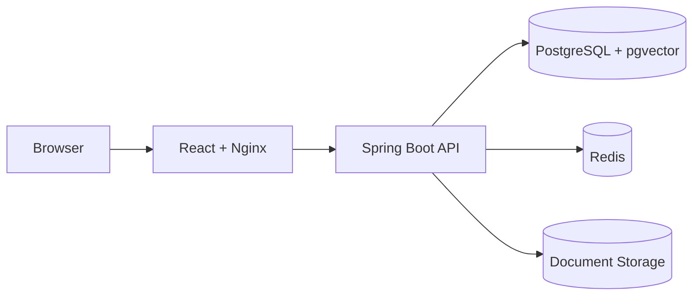
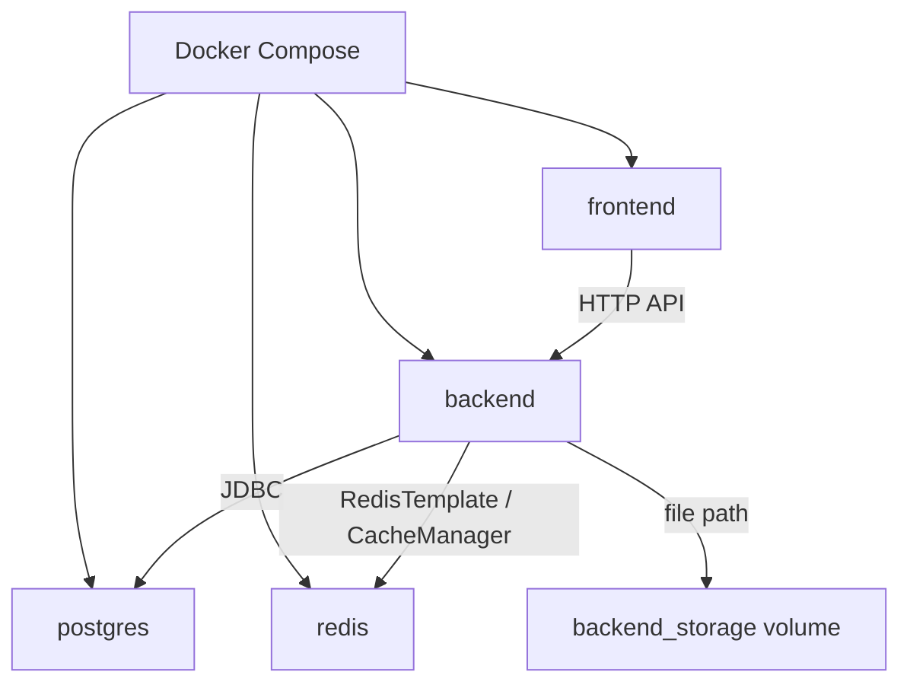
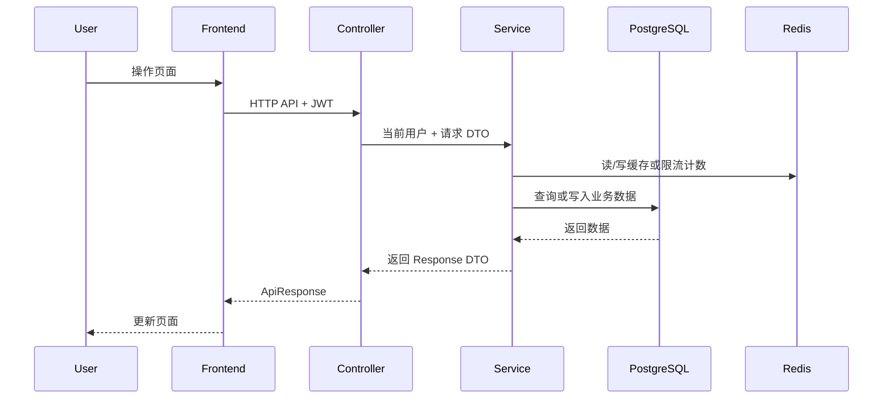

# 系统架构

## 总览

本项目采用前后端分离架构，后端负责业务接口、鉴权、文档处理、RAG 检索与问答；前端负责页面交互；PostgreSQL + pgvector 保存业务数据和向量；Redis 负责缓存和限流。



## 容器架构



## 后端分层

```text
controller  接收 HTTP 请求，处理参数校验和认证用户
service     业务逻辑，例如注册、知识库管理、文档处理、聊天
repository  数据库访问，基于 Spring Data JPA 或 JdbcTemplate
entity      数据库表对应的领域对象
dto         接口入参和出参
config      安全、CORS、Redis、异步线程池等配置
common      通用响应、异常、分页、缓存、限流、日志
```

## 后端请求链路



## 关键设计

```text
JWT 鉴权：登录后前端保存 token，后续请求带 Authorization: Bearer token。
用户隔离：查询资源时都带 userId 条件，避免用户访问他人数据。
统一响应：所有接口返回 ApiResponse，前端处理逻辑一致。
统一异常：BusinessException 和参数校验异常由 GlobalExceptionHandler 转成标准响应。
缓存策略：知识库列表、详情、文档列表、详情、状态使用 Redis 缓存。
缓存失效：创建、更新、删除、解析文档后主动删除相关缓存。
异步处理：上传文档后立即返回，后台执行解析、切分、向量化。
限流：聊天接口按用户维度限制请求频率。
```

## 部署入口

```text
docker-compose.yml
backend/Dockerfile
frontend/Dockerfile
frontend/nginx.conf
.env.example
```
