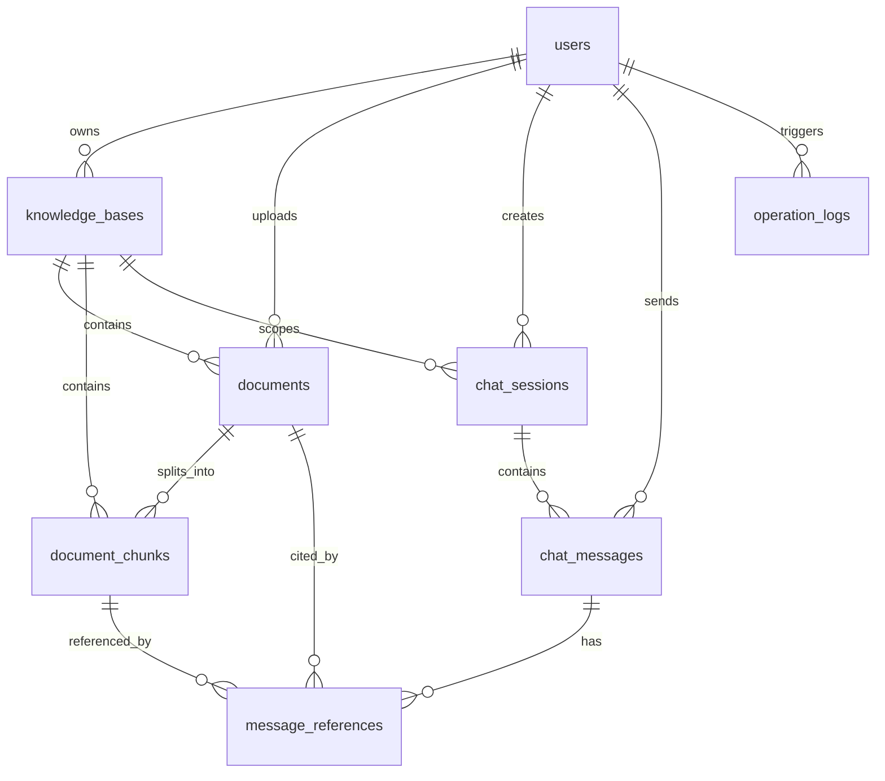

# 数据库设计

数据库使用 PostgreSQL 16，并通过 pgvector 扩展支持向量字段。

初始化脚本：

```text
docker/postgres/init/01-create-vector-extension.sql
docker/postgres/init/02-schema.sql
```

完整建表 SQL 也可以参考：

```text
docs/database-schema.sql
```

## 表关系



## 核心表

```text
users
```

保存平台用户，包括用户名、密码哈希、昵称、角色和状态。

```text
knowledge_bases
```

保存用户创建的知识库。`user_id + name` 唯一，保证同一个用户不能创建同名知识库。

```text
documents
```

保存上传文档的元数据，包括文件名、类型、大小、存储路径和处理状态。

处理中的文档还会保存 `parse_progress`（0–100）和 `parse_stage`，供前端轮询显示实时解析进度。已有数据库需要先执行 `docker/postgres/migrations/20260928_add_document_parse_progress.sql`。

状态包括：

```text
PENDING
PROCESSING
COMPLETED
FAILED
```

```text
document_chunks
```

保存文档切分后的文本片段和向量。

关键字段：

```text
document_id
knowledge_base_id
chunk_index
content
search_text
embedding VECTOR(1024)
```

```text
chat_sessions
```

保存聊天会话，一个会话绑定一个知识库。

```text
chat_messages
```

保存用户消息和助手消息。

角色包括：

```text
USER
ASSISTANT
```

```text
message_references
```

保存助手回答引用了哪些文档 chunk。

关键字段：

```text
message_id
document_id
chunk_id
similarity
```

```text
operation_logs
```

预留操作日志表，用于记录重要用户或系统行为。

## 删除策略

```text
删除 knowledge_base -> 级联删除 documents、document_chunks、chat_sessions
删除 document -> 级联删除 document_chunks 和相关引用
删除 chat_message -> 级联删除 message_references
删除 user -> 大部分业务数据限制删除，operation_logs 中 user_id 可置空
```

## 索引设计

常用查询都加了索引：

```text
documents(knowledge_base_id)
documents(user_id)
documents(status, created_at)
document_chunks(knowledge_base_id)
document_chunks(search_text)  -- GIN to_tsvector('simple', search_text)
chat_sessions(user_id, updated_at DESC)
chat_messages(session_id, created_at, id)
message_references(document_id)
message_references(chunk_id)
operation_logs(user_id, created_at DESC)
```

这些索引用来支持：

```text
按用户查知识库
按知识库查文档
按状态查文档处理任务
按知识库做向量检索
按会话查聊天记录
按回答查引用来源
```
