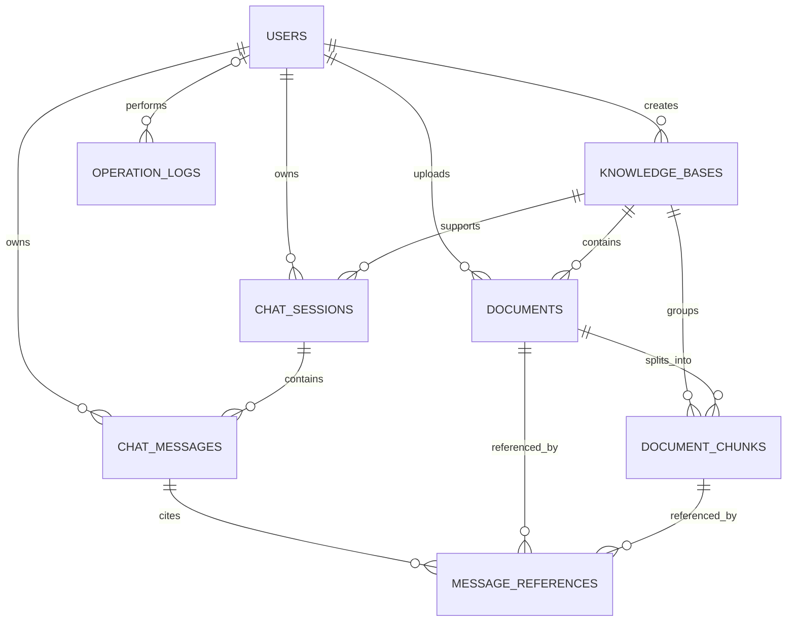

# RAG 知识库平台 ER 设计

## 1. 表关系概览



符号说明：

- `||`：必须且只有一条记录。
- `o|`：可以没有，也可以有一条记录。
- `o{`：可以没有，也可以有多条记录。

## 2. 关系说明

| 主表 | 从表 | 关系 | 外键 | 业务含义 |
| --- | --- | --- | --- | --- |
| `users` | `knowledge_bases` | 一对多 | `knowledge_bases.user_id` | 用户创建知识库 |
| `users` | `documents` | 一对多 | `documents.user_id` | 用户上传文档 |
| `knowledge_bases` | `documents` | 一对多 | `documents.knowledge_base_id` | 知识库包含文档 |
| `documents` | `document_chunks` | 一对多 | `document_chunks.document_id` | 文档被拆分成文本块 |
| `knowledge_bases` | `document_chunks` | 一对多 | `document_chunks.knowledge_base_id` | 文本块直接归属知识库，便于向量检索 |
| `users` | `chat_sessions` | 一对多 | `chat_sessions.user_id` | 用户拥有问答会话 |
| `knowledge_bases` | `chat_sessions` | 一对多 | `chat_sessions.knowledge_base_id` | 会话基于一个知识库 |
| `chat_sessions` | `chat_messages` | 一对多 | `chat_messages.session_id` | 会话包含多条消息 |
| `users` | `chat_messages` | 一对多 | `chat_messages.user_id` | 消息归属于会话用户 |
| `chat_messages` | `message_references` | 一对多 | `message_references.message_id` | AI 回答包含多个引用 |
| `documents` | `message_references` | 一对多 | `message_references.document_id` | 引用指向来源文档 |
| `document_chunks` | `message_references` | 一对多 | `message_references.chunk_id` | 引用指向具体文本块 |
| `users` | `operation_logs` | 一对多 | `operation_logs.user_id` | 记录用户操作，系统操作可不关联用户 |

## 3. 关键设计决定

### 3.1 文本块保留知识库 ID

`document_chunks.knowledge_base_id` 可以通过 `document_id` 间接查询，但直接保存后，向量检索可以按知识库快速过滤：

```sql
WHERE knowledge_base_id = :knowledgeBaseId
ORDER BY embedding <=> :queryEmbedding
```

这是为了提高查询便利性而保留的冗余字段，后端写入时必须确保文本块和文档属于同一个知识库。

### 3.2 消息引用只关联 AI 回答

`message_references.message_id` 应当指向 `role = 'ASSISTANT'` 的消息。数据库外键只能保证消息存在，消息角色由后端业务逻辑校验。

### 3.3 操作日志使用通用资源标识

`operation_logs.resource_type` 和 `resource_id` 可以表示不同资源，例如：

```text
resource_type = DOCUMENT
resource_id = 1001
```

因为 `resource_id` 可能指向不同表，所以不为它设置固定外键。

## 4. 删除策略

| 删除对象 | 处理方式 |
| --- | --- |
| 用户 | MVP 阶段禁用用户，不直接物理删除 |
| 知识库 | 级联删除文档、文本块、会话、消息和引用 |
| 文档 | 级联删除文本块及相关引用 |
| 会话 | 级联删除消息和引用 |
| 消息 | 级联删除该消息的引用 |
| 操作日志 | 长期保留；用户不存在时 `user_id` 置空 |

## 5. 核心业务链

```text
用户 -> 知识库 -> 文档 -> 文档分块 -> 向量检索
用户 -> 知识库 -> 会话 -> 消息 -> 引用分块
用户 -> 操作日志
```
