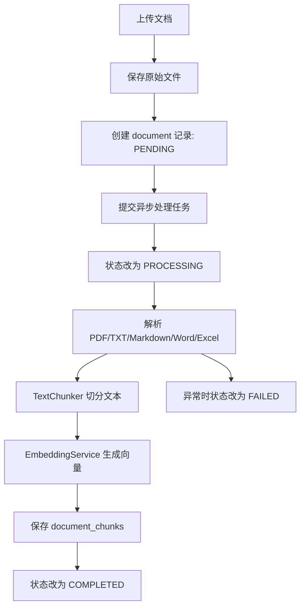
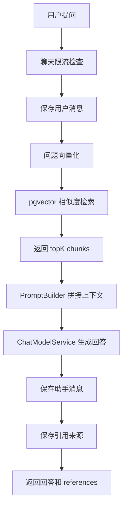

# RAG 流程

RAG 是 Retrieval-Augmented Generation 的缩写，可以理解为“先检索资料，再让模型基于资料回答”。

## 文档入库流程



## 问答流程



## 为什么要切分 Chunk

文档通常比较长，不能整篇直接拿去检索或塞进 Prompt，所以需要切成多个片段。

本项目的切分策略包含：

```text
固定 chunkSize
相邻 chunk 保留 overlap
过滤空白文本
记录 chunkIndex
```

`chunkIndex` 用于记录片段在原文里的顺序，后续展示引用和排查问题时很有用。

## 为什么要 Embedding

Embedding 会把文本变成向量。

```text
"Spring Boot 支持依赖注入" -> [0.12, -0.33, ...]
```

向量可以用来计算语义相似度。用户问“什么是 DI”，系统可以找到“依赖注入”相关 chunk，即使字面不完全相同。

## 为什么要保存引用

RAG 项目不能只返回一个回答，还要告诉用户答案依据来自哪里。

本项目会保存：

```text
assistant message
document id
chunk id
similarity
```

这样前端可以展示“引用来源”，也方便后续做答案追溯。

## 当前实现说明

当前项目默认使用：

```text
EMBEDDING_PROVIDER=mock
CHAT_MODEL_PROVIDER=mock
```

也就是说，本地开发时不需要真实大模型 API Key，就可以跑通完整工程链路。

项目也已经支持切换到真实模型服务，例如 OpenAI：

```text
EMBEDDING_PROVIDER=openai
CHAT_MODEL_PROVIDER=openai
OPENAI_API_KEY=你的 OpenAI API Key
OPENAI_CHAT_MODEL=gpt-5-mini
OPENAI_EMBEDDING_MODEL=text-embedding-3-small
```

切换后，文档入库时会调用 OpenAI Embeddings API 生成真实向量；用户提问时会调用 OpenAI Responses API 生成真实回答。

也可以切换到 Qwen：

```text
EMBEDDING_PROVIDER=qwen
CHAT_MODEL_PROVIDER=qwen
QWEN_API_KEY=你的百炼 API Key
QWEN_CHAT_MODEL=qwen-plus
QWEN_EMBEDDING_MODEL=qwen3.7-text-embedding-flash
EMBEDDING_DIMENSION=1024
```

切换后，文档入库和用户问题向量化都会调用 Qwen embedding；回答生成会调用 Qwen chat completions。
